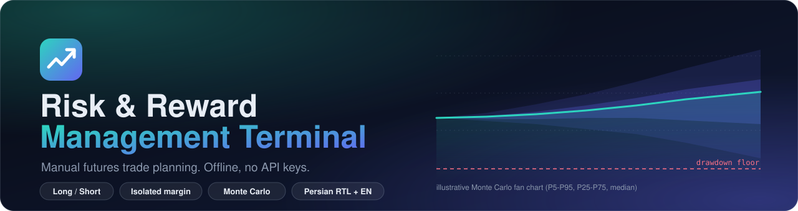
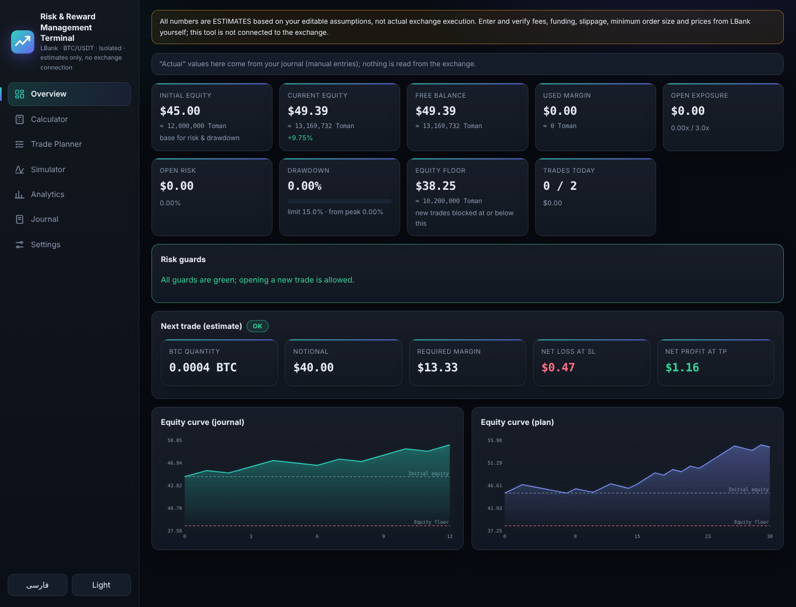
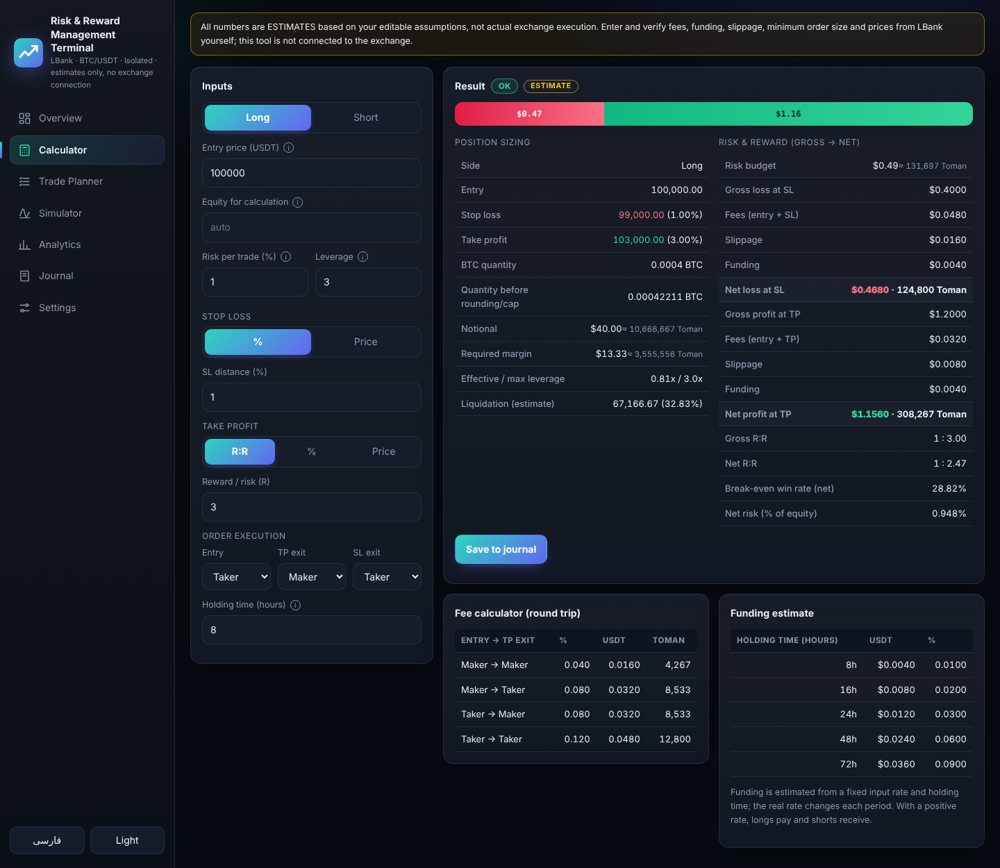
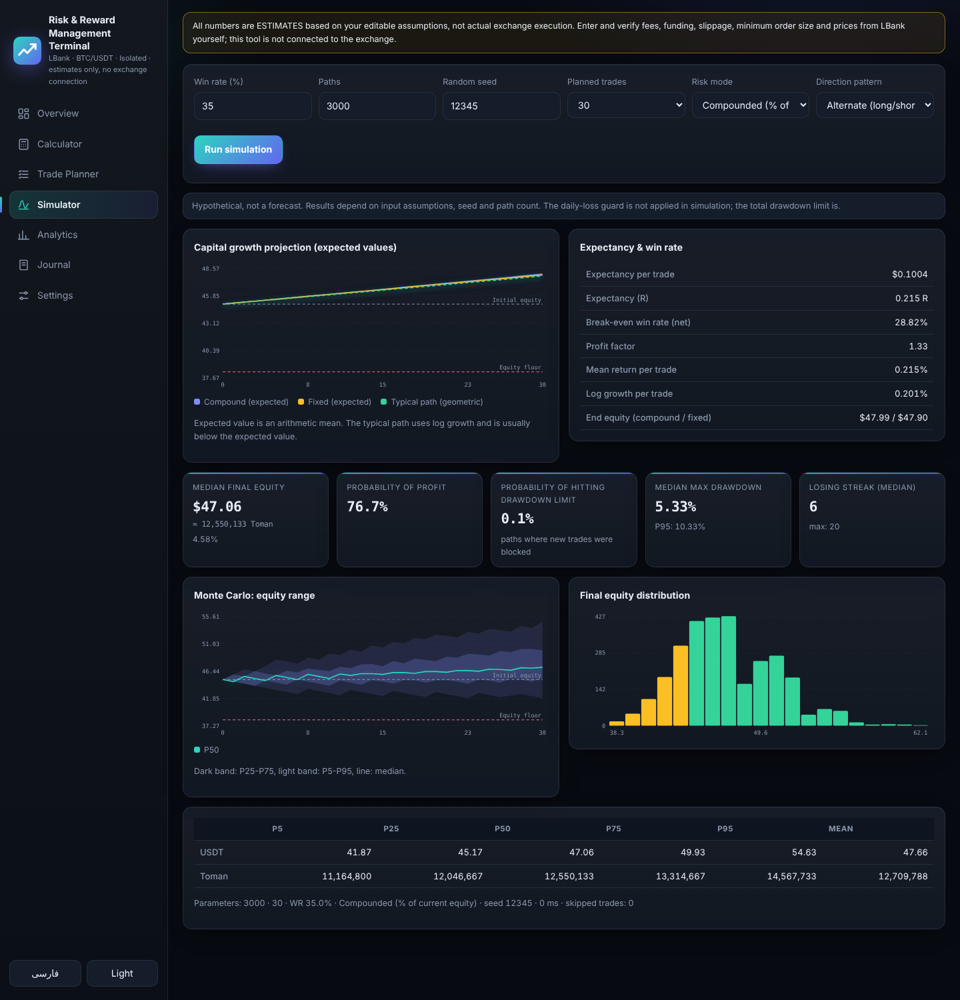
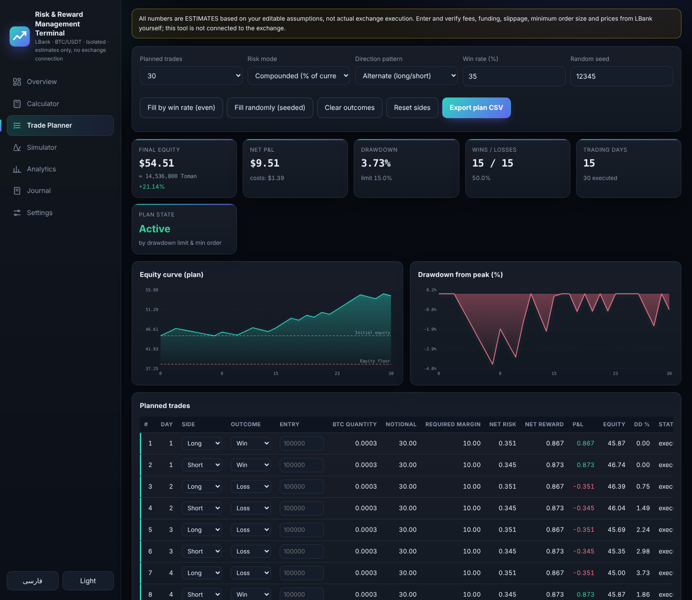
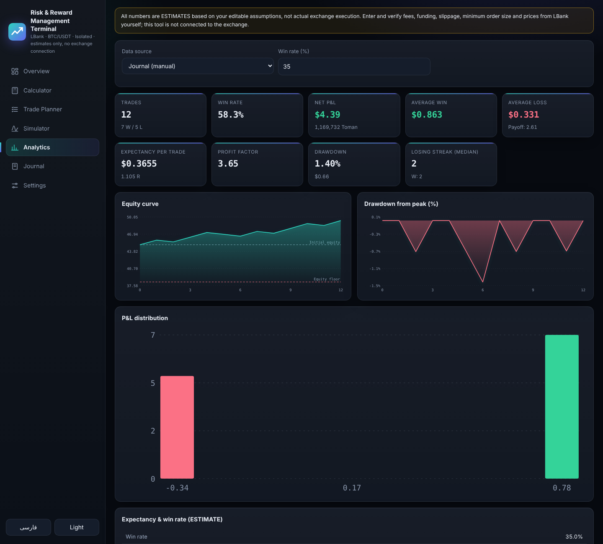
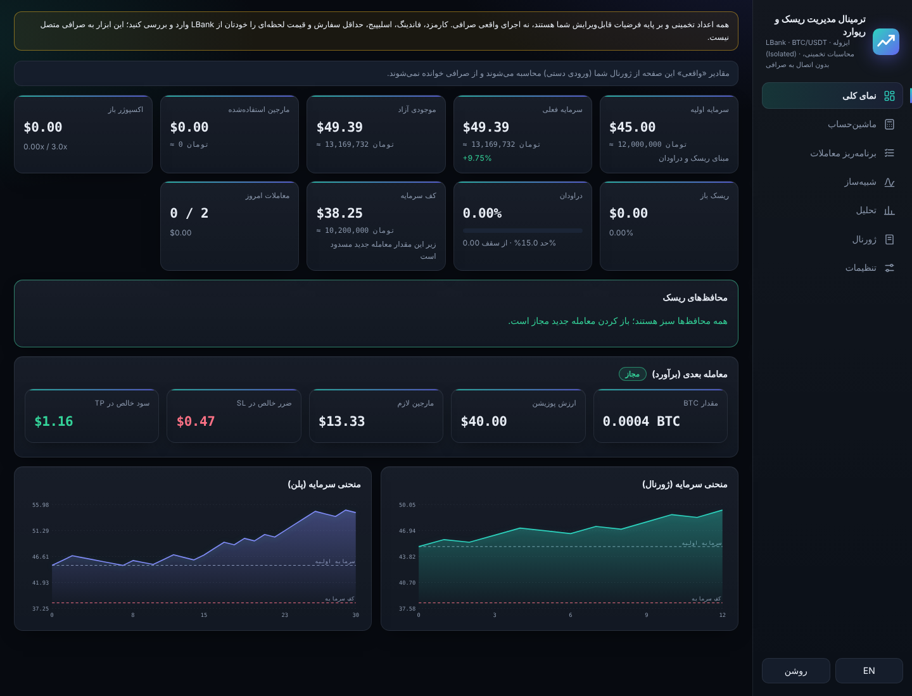
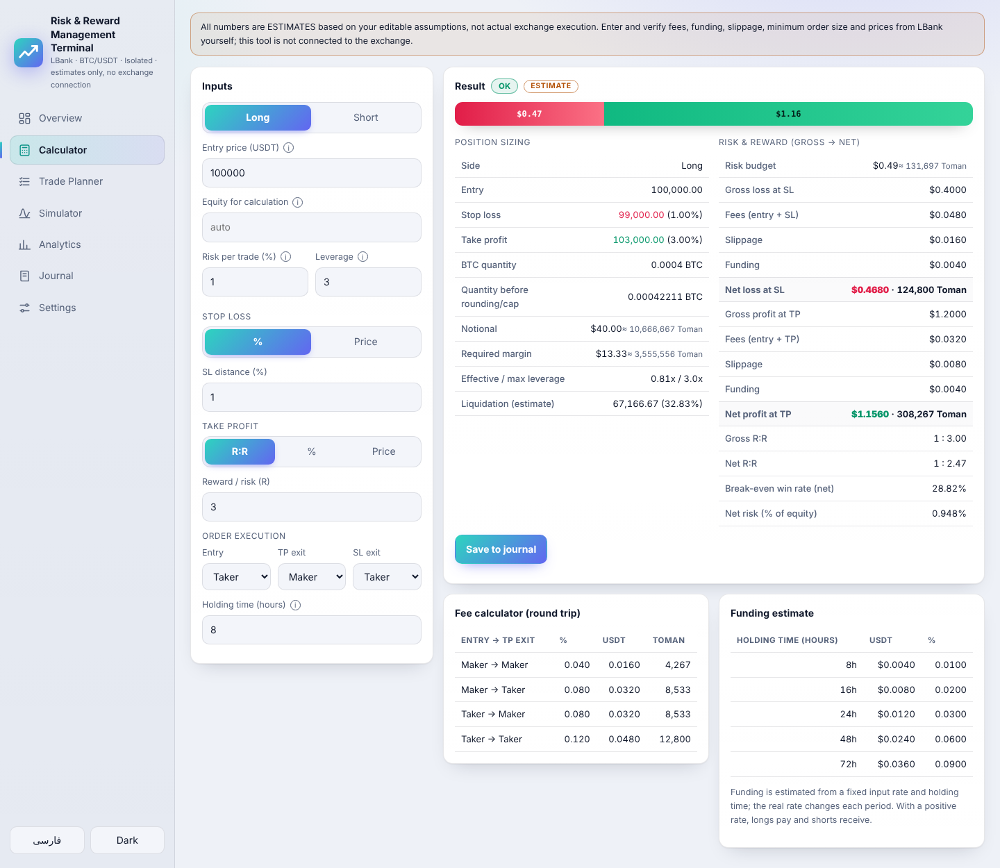
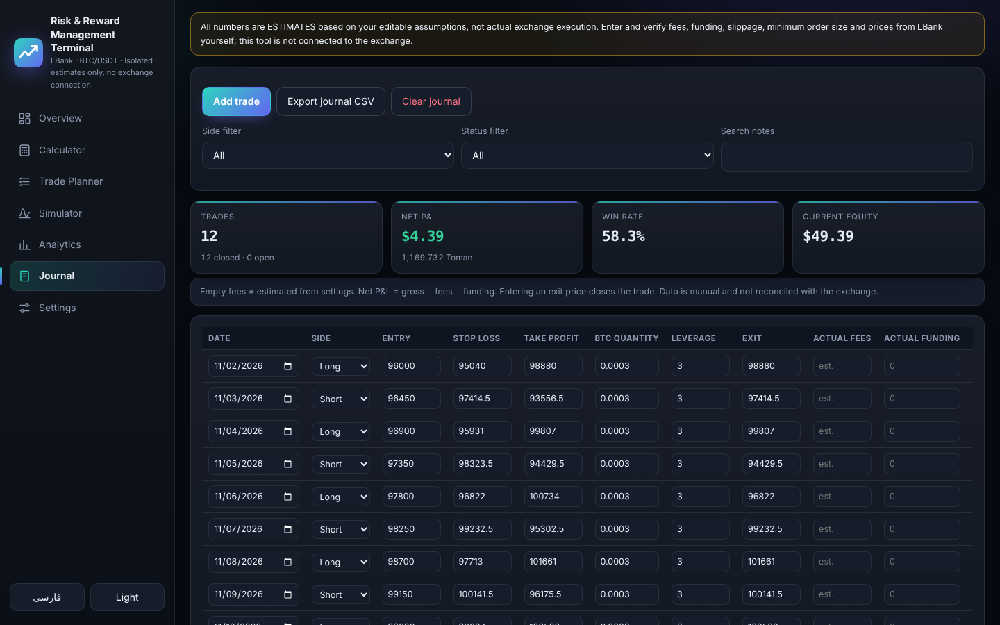

<div align="center">



<br>

**ترمینالی حرفهای و آفلاین برای برنامهريزی معاملات: ابتدا ریسک، سپس حجم پوزیشن.**

**مخزن:** [hamiidza/risk-terminal](https://github.com/hamiidza/risk-terminal) ·
[Issues](https://github.com/hamiidza/risk-terminal/issues) ·
[مجوز (MIT)](LICENSE)

[شروع سریع](#شروع-سریع) · [تصاویر](#تصاویر) · [امکانات](#امکانات) · [نحوه محاسبه اعداد](#نحوه-محاسبه-اعداد) · [محدودیتها](#محدودیتها) · [English](README.md)

</div>

---

## این پروژه چیست؟

**ترمینال مدیریت ریسک و ریوارد** یک ابزار آفلاین و تکفایلی برای برنامهريزی دستی معاملات فیوچرز ارزهای دیجیتال است (پیشفرض: BTC/USDT پرپچوال، مارجین ایزوله، لانگ و شورت).

شما سرمایهٔ حساب، قیمت ورود، فاصلهٔ حد ضرر و فرضیههای هزینهها را وارد میکنید و این ابزار به شما میگوید **چقدر میشود پوزیشن گرفت بدون آنکه قوانین ریسک شکسته شوند**، هزینهٔ معامله چقدر است، پس از کسر کارمزدها چه سودی قابل دستیابی است و یک سری معاملهٔ مشابه چگونه میتواند رفتار کند.

| هست | نیست |
|---|---|
| ماشینحساب تعیین حجم پوزیشن و سناریوها | ربات معاملهگر |
| برنامهريز ۳۰ تا ۵۰۰ معامله و آزمایش مونتکارلو | سامانهٔ اجرای سفارش |
| ژورنال دستی معاملات همراه با تحلیل | متصل به هیچ صرافهای |
| فارسی (RTL) و انگلیسی | منبع قیمت یا کارمزد زنده |

یک فایل HTML است: نه سرور، نه حساب کاربری، نه کلید API و نه هیچ فراخوانی شبکهای.

---

## شروع سریع

**استفادهٔ ساده**

```text
فایل index.html را در هر مرورگر مدرنی باز کنید.
```

> **نسخهٔ آنلاین:** هنوز منتشر نشده است. برنامه را بهصورت محلی با باز کردن `index.html` اجرا کنید یا GitHub Pages را مطابق توضیحات زیر فعال کنید.

**توسعه**

```bash
git clone https://github.com/hamiidza/risk-terminal.git
cd risk-terminal

npm install        # فقط برای تست رابط کاربری (jsdom) لازم است
npm run build      # فایلهای src/* را در index.html قرار میدهد
npm test           # ۳۱ تست موتور محاسبات، بدون وابستگی
npm run test:ui    # ساخت + ۴۱ بررسی رابط کاربری
npm run test:all
```

**انتشار با GitHub Pages**

مخزن در [hamiidza/risk-terminal](https://github.com/hamiidza/risk-terminal) منتشر شده است. GitHub Pages هنوز فعال نشده، بنابراین لینک دموی آنلاینی درج نشده است. برای انتشار: *Settings → Pages → Build and deployment → Deploy from a branch → `main` / root*. پس از اتمام استقرار، آدرس سایت در بخش About مخزن نمایش داده میشود (`index.html` در ریشه قرار دارد).

---

## تصاویر

> تمام تصاویر زیر عکسهای واقعی از برنامهاند (مرورگر headlessChrome با دادههای نمونه)، نه طرحهای تبلیغاتی.

<div align="center">

<sub><b>نمای کلی:</b> سرمایه، مارجین، سنجش دراودان، محافظها، برآورد معاملهٔ بعدی و منحنیهای سرمایه.</sub>
</div>

<br>

<table>
<tr>
<td width="50%"><br><sub><b>ماشینحساب:</b> تعیین حجم، تبدیل ریسک/ریوارد ناخالص به خالص، جدول کارمزد و فاندینگ.</sub></td>
<td width="50%"><br><sub><b>شبیهساز:</b> نمودار مونتکارلو با دامنههای درصدی و توزیع سرمایهٔ نهایی.</sub></td>
</tr>
<tr>
<td width="50%"><br><sub><b>برنامهريز:</b> برنامهٔ متوالی با توقف دراودان و محدودیتهای روزانه.</sub></td>
<td width="50%"><br><sub><b>تحلیلها:</b> امید ریاضی، فاکتور سود، دراودان و توزیع سود/زیان.</sub></td>
</tr>
<tr>
<td width="50%"><br><sub><b>فارسی RTL:</b> رابط کاملاً راستبهچپ.</sub></td>
<td width="50%"><br><sub><b>تم روشن:</b> مناسب محیطهای پرنور و چاپ.</sub></td>
</tr>
</table>

<div align="center">

<sub><b>ژورنال:</b> رکوردهای قابل ویرایش، کارمزدهای برآوردی در برابر واقعی، مضربهای R و خروجی CSV.</sub>
</div>

---

## امکانات

- **تعیین حجم پوزیشن** بر اساس بودجهٔ ریسک و فاصلهٔ حد ضرر، برای لانگ و شورت.
- **حد ضرر و حد سود** بر اساس درصد، قیمت یا نسبت ریسک به ریوارد؛ محاسبهٔ خودکار مقدار BTC با گرد کردن **به پایین** تا گام لات.
- **لورج و مارجین**: مارجین مورد نیاز، لورج مؤثر، قیمت تصفیهٔ تخمینی و جلوگیری از حد ضرر فراتر از تصفیه.
- **هزینهها**: کارمزد میکر/تیکر برای هرleg، اسلیپیج، تخمین فاندینگ با در نظر گرفتن مدت نگهداری.
- **ناخالص در برابر خالص**: ریسک، پاداش، نسبت R:R و نرخ برد سر به سوددهی (break-even) در کنار هم.
- **تبدیل دلار و تومان/ریال** با نرخ دستی قابل ویرایش (هیچگاه بهصورت زنده دریافت نمیشود).
- **محافظهای ایمنی**: سقف لورج، کف دراودان کل، محدودیت تعداد معاملات روزانه، حداکثر ضرر روزانه و حداکثر باختهای پشت سر هم. هیچ چیز بهصورت خاموش محدود نمیشود؛ همیشه پیام نمایش داده میشود.
- **برنامهريز** برای ۳۰، ۵۰، ۱۰۰، ۲۵۰ یا ۵۰۰ معامله؛ ریسک مرکب یا مبلغ ثابت؛ نتیجهٔ پرشدن بر اساس نرخ برد یا تصادف با seed.
- **مونتکارلو** با seed، تعداد مسیرها و باندهای درصدی؛ پیشبینی رشد (مسیر مورد انتظار در برابر معمولی).
- **امید ریاضی، فاکتور سود، دراودان، رشتهها** برای ژورنال یا برنامهريز.
- **ژورنال معاملات** با ویرایش در محل، فیلتر و خروجی CSV (ایمن در برابر تزریق فرمول و سازگار با Excel با BOM یوتف-۸).
- **فارسی RTL + انگلیسی**، تم تیره و روشن، قابل دسترس با صفحهکلید، واکنشگرا تا عرض گوشی و رعایت کاهش حرکت.
- **همهٔ مقادیر قابل ویرایشاند** و در مرورگر ذخیره میشوند.

---

## تکنولوژیها

- JavaScript خالص (بدون فریمورک)، HTML و CSS
- موتور محاسبات خالص بدون DOM در `src/engine.js`
- اسکریپت ساخت ساده در `scripts/build.js` بدون bundler (فقط Node.js)
- تستها با Node.js و jsdom (فقط وابستگی توسعه)
- ذخیرهسازی محلی با `localStorage` مرورگر — بدون سرور و بدون ارسال داده

ساختار پروژه:

```text
risk-terminal/
├── index.html              برنامهٔ تکفایلی ساختهشده
├── src/
│   ├── engine.js           موتور محاسبات خالص، بدون DOM
│   ├── app1.js             وضعیت، قالببندی، نمودارها و حساب ژورنال
│   ├── app2.js             ساخت صفحه و رندر تبها
│   ├── app3.js             رویدادها، همگامسازی و راهاندازی
│   ├── i18n.js             فرهنگ لغت فارسی / انگلیسی
│   ├── style.css           سیستم طراحی (تیره + روشن)
│   └── template.html
├── scripts/build.js        جایگذاری تمام فایلها در index.html
├── tests/
│   ├── engine.test.js      ۳۱ تست واحد
│   └── ui.smoke.test.js    ۴۱ بررسی رابط کاربری
└── assets/                 لوگو، بنر، نمودارها و تصاویر واقعی
```

---

## نحوه محاسبه اعداد

اگر `E` سرمایه، `r` کسر ریسک، `s` فاصلهٔ حد ضرر، `L` لورج و `P` قیمت ورود باشد:

```text
بودجهٔ ریسک     R = E × r                      (محدود به باقیمانده تا کف دراودان)
تعداد           Q = floor_to_step( R / (s + costs) / P )
ارزش اسمی       N = Q × P
مارجین          M = N / L
حد ضرر (لانگ)   P × (1 − s)        حد ضرر (شورت)   P × (1 + s)
حد سود (لانگ)   P × (1 + s × RR)   حد سود (شورت)   P × (1 − s × RR)
ضرر خالص در SL = ضرر ناخالص + کارمزد ورود + کارمزد SL + اسلیپیج + فاندینگ
سود خالص در TP  = سود ناخالص − کارمزد ورود − کارمزد TP − اسلیپیج − فاندینگ
```

- **لورج میزان ریسک دلاری شما را تغییر نمیدهد**؛ فقط مارجین لازم را تعیین میکند. حجم از ریسک و فاصلهٔ حد ضرر بهدست میآید و لورج پس از آن بررسی میشود.
- با فعال بودن گزینهٔ «کارمزدها و اسلیپیج داخل بودجهٔ ریسک» (پیشفرض)، هزینهها در تعیین حجم لحاظ میشوند تا **ضرر خالص در حد ضرر هرگز از ریسک تنظیمشده فراتر نرود**.
- تعداد همیشه **به پایین** گرد میشود، بنابراین گرد کردن تنها ریسک را کاهش میدهد.
- **کف سرمایه** `= سرمایهٔ اولیه × (1 − حداکثر دراودان)`؛ در یا پایینتر از آن معاملات جدید مسدود میشوند.
- **قیمت تصفیه** یک فرمول سادهٔ مارجین ایزوله است `P × (1 ∓ (1/L − mmr))` و تنها تخمینی است.
- **مونتکارلو** با PRNG دارای seed (`mulberry32`) نتایج برد/باخت را میکشد؛ seed یکسان نتیجهٔ یکسان میدهد. این یک *مدل* است، نه پیشبینی.

---

## دادهها و حریم خصوصی

تنظیمات، ژورنال و برنامهريز در `localStorage` مرورگر تحت کلیدهای `rrt.*` ذخیره میشوند. هیچ اطلاعاتی به جایی ارسال نمیشود. پاک کردن دادههای سایت آنها را حذف میکند؛ برای پشتیبانگیری از **خروجی CSV** استفاده کنید.

---

## تستها

| مجموعه | پوشش | نتیجه |
|---|---|---|
| `tests/engine.test.js` | جهت SL/TP، تعیین حجم، گرد کردن به پایین، سقف لورج و مارجین، کارمزدها، علامت فاندینگ، کف دراودان، حداقل حجم، ورودیهای نامعتبر، تصفیه، برنامهريز، محدودیتهای روزانه، تکرارپذیری مونتکارلو، تحلیلها، فرار از CSV و FX | **۳۱ / ۳۱** |
| `tests/ui.smoke.test.js` | راهاندازی واقعی `index.html` در jsdom، اجرای تمام تبها، مقایسهٔ اعداد رابط با موتور، ژورنال، برنامهريز، شبیهساز، تغییر زبان، بازنشانی و تأیید **عدم وجود خطای JS** | **۴۱ / ۴۱** |

---

## محدودیتها

- تمام پیشفرضهای کارمزد، فاندینگ، اسلیپیج، گام لات، حداقل حجم و مارجین نگهداری **مقادیر جایگزیناند** و باید با مقادیر رسمی صرافی تطبیق داده شوند.
- در سرمایههای خیلی کوچک، حداقل حجم صرافی ممکن است معاملهٔ ۱٪ ریسک را غیرممکن کند؛ ماشینحساب بهجای افزایش خاموش ریسک، آن را مسدود میکند.
- قیمت تصفیه تخمینی است و فاندینگ از نرخ ثابت استفاده میکند.
- ژورنال دستی است و با صرافی تطبیق داده نمیشود.
- محدودیت ضرر روزانه در مونتکارلو اعمال نمیشود؛ محدودیت دراودان کل اعمال میشود.
- در حال حاضر تنها یک پروفایل ابزار و فقط فیوچرز خطی با مارجین USDT پشتیبانی میشود.

---

## سلب مسئولیت

این برنامه یک ابزار تحلیلی و آموزشی مدیریت ریسک است. معاملهای اجرا نمیکند، به صرافیها متصل نمیشود و توصیهای مالی ارائه نمیدهد. محاسبات بر اساس فرضیات واردشده توسط کاربر انجام میشوند و ممکن است با رفتار واقعی صرافی متفاوت باشند. معاملهٔ مشتقات اهرمیی میتواند بیش از انتظار شما زیان به همراه داشته باشد.

## مجوز

[MIT](LICENSE)
