<div align="center">

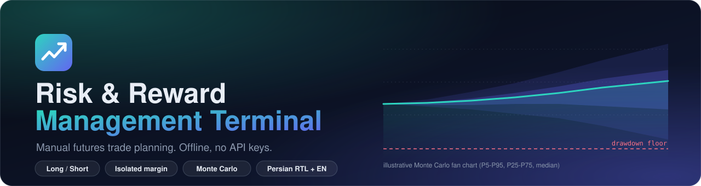

<br>


**A premium, offline terminal for planning trades the way professionals do: risk first, size second.**

[Quick start](#quick-start) ·
[Screenshots](#screenshots) ·
[Features](#features) ·
[How it works](#how-the-numbers-work) ·
[Limitations](#limitations) ·
[فارسی](#خلاصه-فارسی)

</div>

---

## What is this?

**Risk & Reward Management Terminal** is a manual trade-planning and risk-management tool for crypto futures traders (defaults: BTC/USDT perpetual, isolated margin, long and short).

You type your account size, entry, stop distance and cost assumptions. It tells you **how big the position can be without breaking your risk rules**, what the trade costs, what you can realistically win after fees, and how a series of such trades might behave.

It is one HTML file. No server, no account, no API keys, no network calls.

| It is | It is not |
|---|---|
| A position-sizing and scenario calculator | A trading bot |
| A 30-to-500 trade planner and Monte Carlo lab | An order execution system |
| A manual trade journal with analytics | Connected to any exchange |
| Persian (RTL) and English | A source of live prices or fees |

---

## Screenshots

> All images below are real captures of the application (headless Chrome, sample journal data), not mock-ups.

<div align="center">
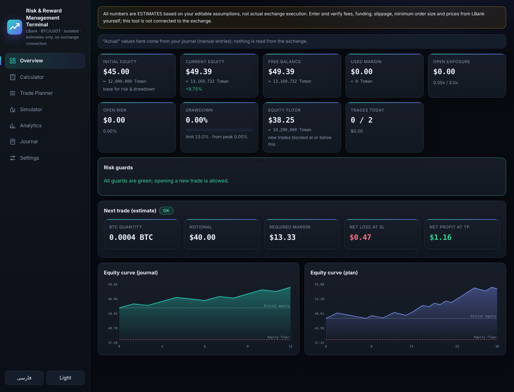
<sub><b>Overview</b>: account, margin, drawdown meter, risk guards, next-trade estimate and equity curves.</sub>
</div>

<br>

<table>
<tr>
<td width="50%">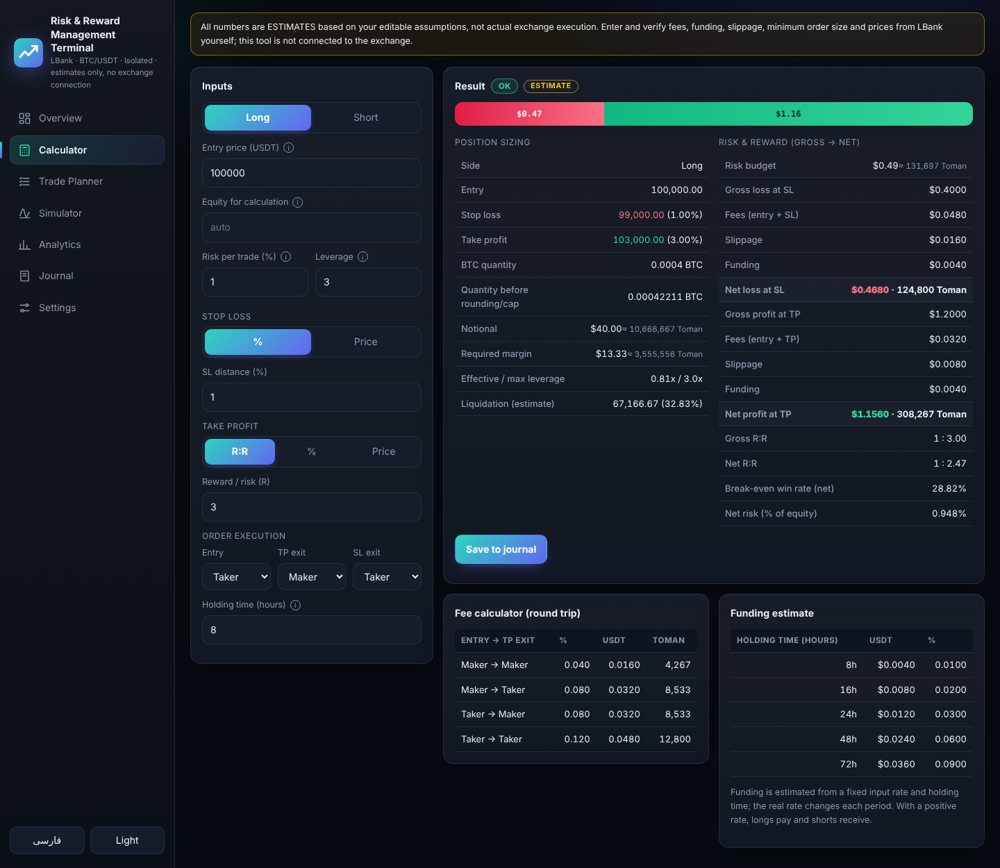<br><sub><b>Calculator</b>: sizing, gross to net risk/reward, fee and funding tables.</sub></td>
<td width="50%">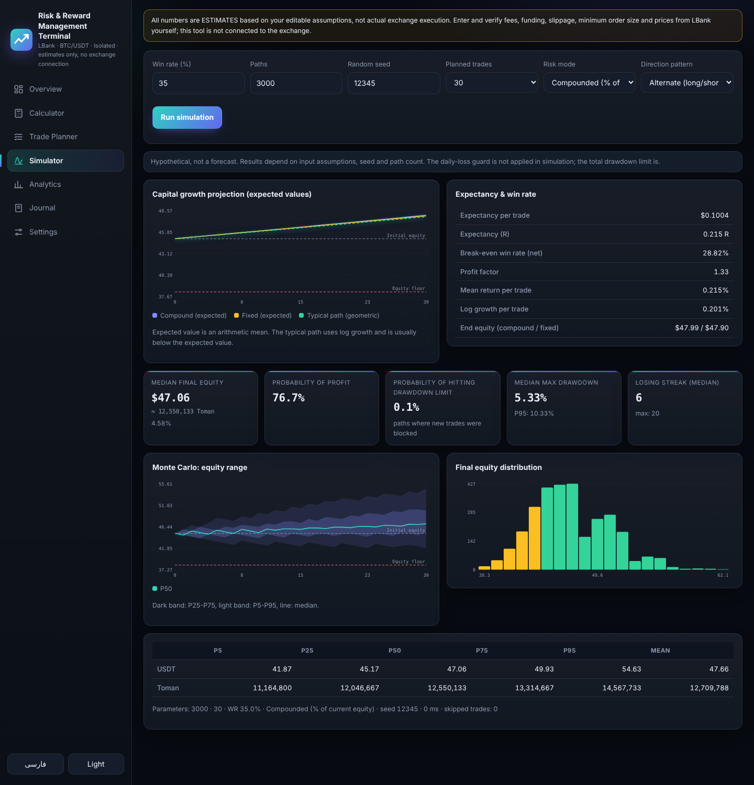<br><sub><b>Simulator</b>: seeded Monte Carlo fan chart and final-equity distribution.</sub></td>
</tr>
<tr>
<td width="50%">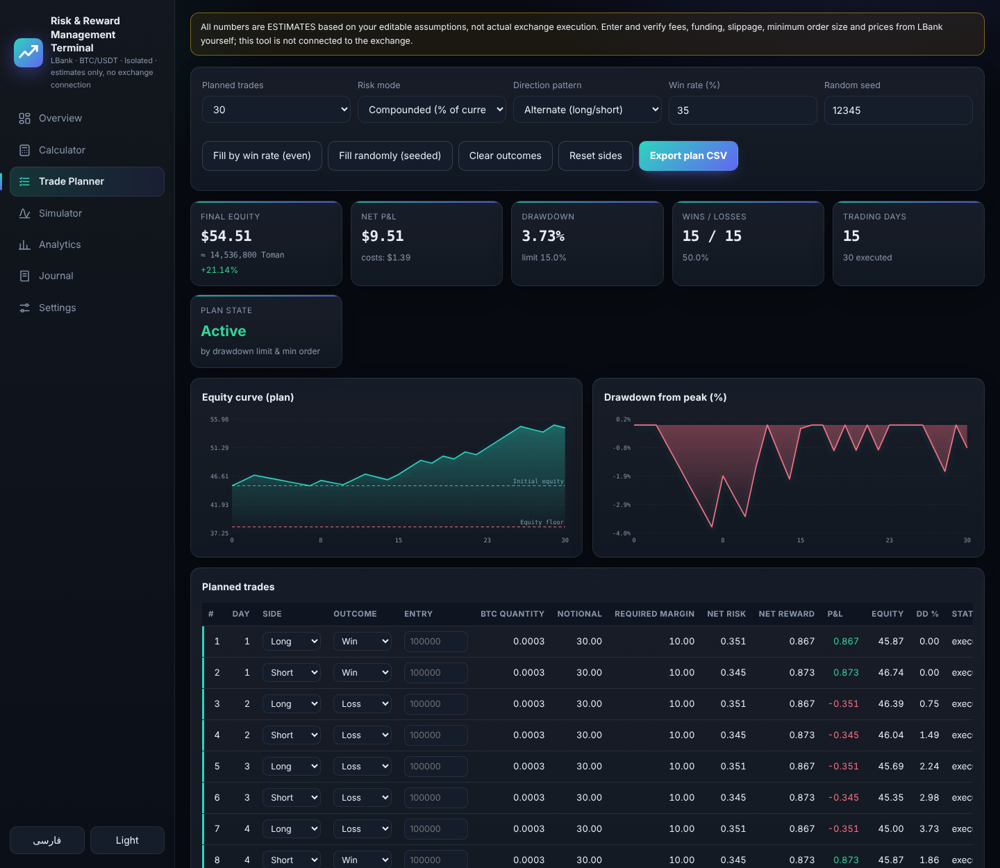<br><sub><b>Planner</b>: sequential plan with drawdown halt and daily limits.</sub></td>
<td width="50%">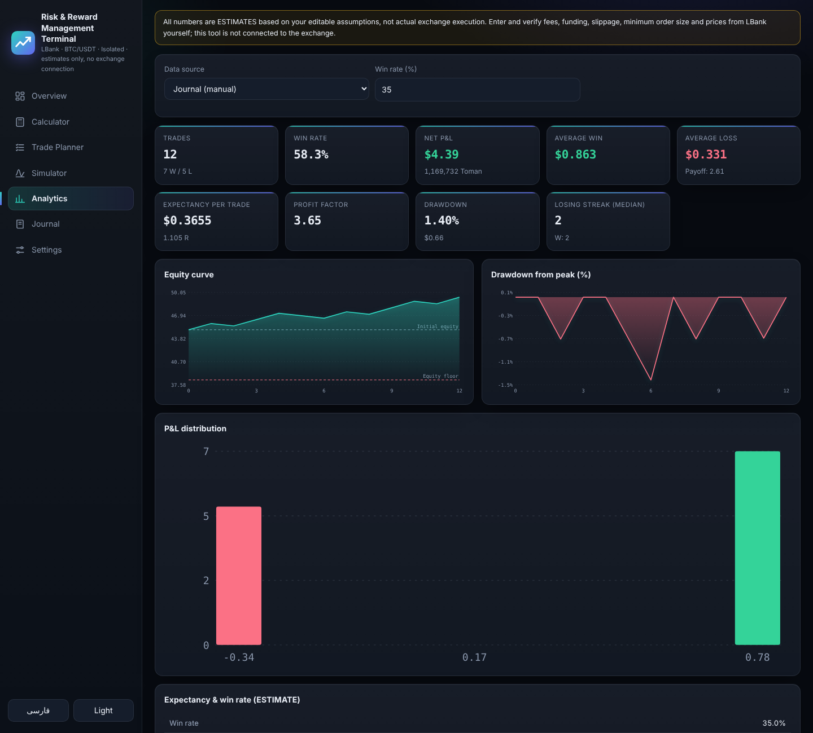<br><sub><b>Analytics</b>: expectancy, profit factor, drawdown and P&amp;L distribution.</sub></td>
</tr>
<tr>
<td width="50%">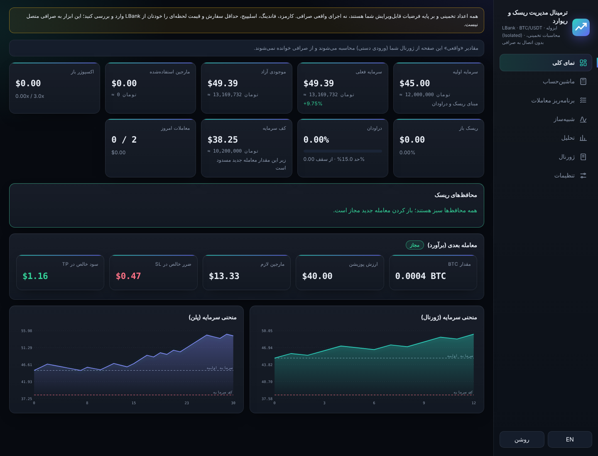<br><sub><b>Persian RTL</b>: full right-to-left interface.</sub></td>
<td width="50%">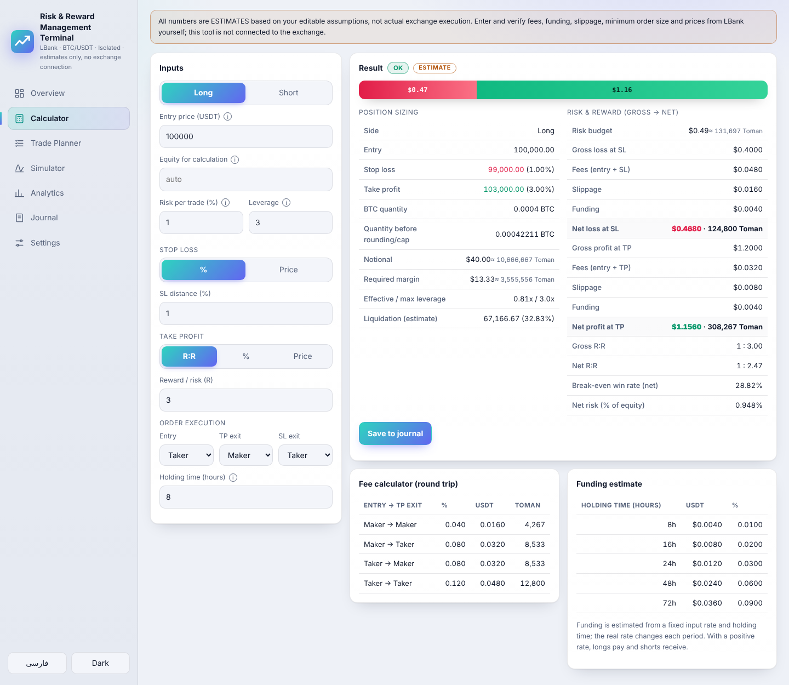<br><sub><b>Light theme</b> for bright rooms and printing.</sub></td>
</tr>
</table>

<div align="center">
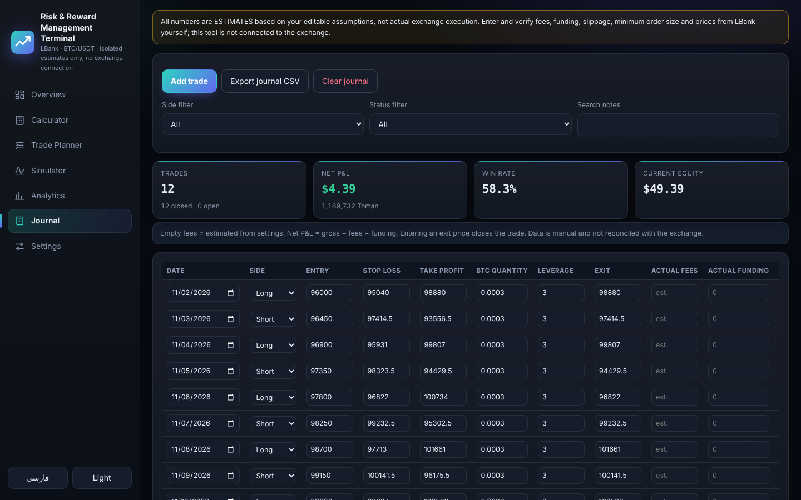
<sub><b>Journal</b>: editable manual records, estimated vs actual fees, R multiples, CSV export.</sub>
<br><br>
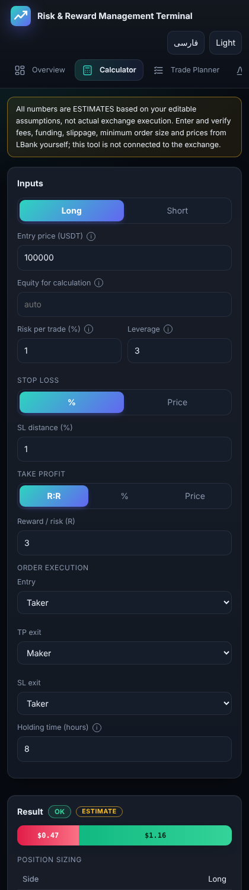
<br><sub><b>Mobile</b>: the same calculator on a 420 px screen.</sub>
</div>

---

## Features

<div align="center">
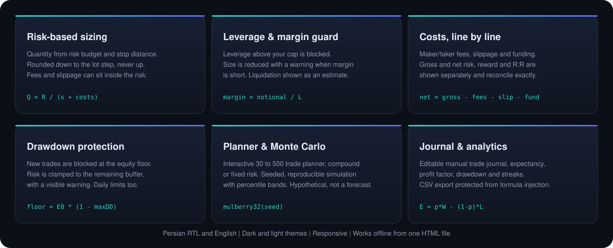
</div>

<br>

- **Position sizing** from risk budget and stop distance, for Long and Short.
- **Stop and target by percent, price or R:R**; automatic BTC quantity, rounded **down** to the lot step.
- **Leverage and margin**: required margin, effective leverage, estimated liquidation price, stop-beyond-liquidation block.
- **Costs**: maker/taker fees per leg, slippage per market leg, funding estimator with hold time.
- **Gross vs net** risk, reward, R:R and break-even win rate, shown side by side.
- **USD and Toman/Rial** conversion with an editable manual rate (never fetched live).
- **Safety rails**: leverage cap, total drawdown floor, daily trade limit, daily loss limit, consecutive-loss limit. Nothing is capped or clamped silently; you always get a visible message.
- **Planner** for 30, 50, 100, 250 or 500 trades; compound or fixed-dollar risk; fill outcomes by win rate or by seeded random.
- **Monte Carlo** with seed, path count and percentile bands; **growth projection** (expected vs typical path).
- **Expectancy, profit factor, drawdown, streaks** for either the journal or the planner.
- **Trade journal** with inline editing, filters and **CSV export** (formula-injection safe, Excel-friendly UTF-8 BOM).
- **Persian RTL + English**, dark and light themes, keyboard accessible, responsive down to phone width, respects reduced motion.
- **Everything is editable** in Settings and persisted in your browser.

---

## Quick start

**Just use it**

```text
Open  index.html  in any modern browser.
```

**Develop**

```bash
git clone <your-repo-url>
cd risk-reward-terminal

npm install        # only needed for the UI smoke test (jsdom)
npm run build      # inlines src/* into index.html
npm test           # 31 engine tests, no dependencies
npm run test:ui    # build + 41 jsdom UI checks
npm run test:all
```

**Publish with GitHub Pages**

1. Push the repository to GitHub.
2. *Settings → Pages → Build and deployment → Deploy from a branch → `main` / root.*
3. Your terminal is live at `https://<user>.github.io/<repo>/` (`index.html` is already at the root).

---

## Architecture

<div align="center">
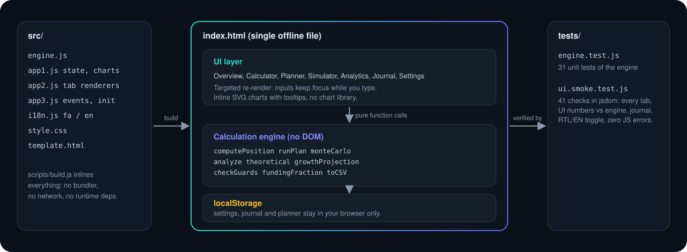
</div>

```text
risk-reward-terminal/
├── index.html              built single-file app (generated)
├── src/
│   ├── engine.js           pure calculation engine, no DOM
│   ├── app1.js             state, formatting, SVG charts, journal math
│   ├── app2.js             page construction and tab renderers
│   ├── app3.js             events, sync, init
│   ├── i18n.js             Persian / English dictionary
│   ├── style.css           design system (dark + light)
│   └── template.html
├── scripts/build.js        inlines everything, no bundler
├── tests/
│   ├── engine.test.js      31 unit tests
│   └── ui.smoke.test.js    41 jsdom checks
└── assets/                 logo, banner, diagrams, real screenshots
```

---

## How the numbers work

Let `E` = equity, `r` = risk fraction, `s` = stop distance (fraction), `L` = leverage, `P` = entry.

```text
Risk budget      R = E × r                      (clamped to the buffer left before the drawdown floor)
Quantity         Q = floor_to_step( R / (s + costs) / P )
Notional         N = Q × P
Margin           M = N / L
Stop (long)      P × (1 − s)         Stop (short)   P × (1 + s)
Target (long)    P × (1 + s × RR)    Target (short) P × (1 − s × RR)
Net loss at SL   = gross loss + entry fee + SL fee + slippage + funding
Net win at TP    = gross win − entry fee − TP fee − slippage − funding
```

- **Leverage does not change your dollar risk.** It only changes the margin you must post. Size comes from risk and stop distance; leverage is validated afterwards.
- With *“fees & slippage inside risk budget”* enabled (default), costs are included when sizing, so **net loss at the stop never exceeds your configured risk**. Turn it off to use the pure `R / s` formula.
- Quantity is always rounded **down**, so rounding can only lower your risk. On small accounts this can be a large relative effect; the calculator shows it.
- **Equity floor** `= initial × (1 − maxDrawdown)`. At or below it, new trades are blocked.
- **Liquidation** uses a simplified isolated-margin formula `P × (1 ∓ (1/L − mmr))`. It is an estimate, not an exchange value.
- **Monte Carlo** draws win/loss with a seeded PRNG (`mulberry32`); the same seed gives the same result. It is a *model*, not a forecast.

---

## Data and privacy

Settings, journal and planner are stored in your browser's `localStorage` under the `rrt.*` keys. Nothing is sent anywhere. Clearing site data removes them; use **Export CSV** for backups.

---

## Testing

| Suite | What it covers | Result |
|---|---|---|
| `tests/engine.test.js` | Long/Short levels, sizing, rounding down, leverage and margin caps, fees, funding sign, drawdown floor and clamp, minimum quantity, invalid input, liquidation, planner reconciliation, daily limits, Monte Carlo determinism and extremes, analytics, CSV escaping, FX | **31 / 31** |
| `tests/ui.smoke.test.js` | Boots the real `index.html` in jsdom, drives every tab, compares UI numbers to the engine, journal P&L, planner, simulator, language toggle, reset, and asserts **zero JS errors** | **41 / 41** |

---

## Limitations

Please read these before relying on any number.

- **All fees, funding, slippage, lot step, minimum size and maintenance margin defaults are placeholders**, not LBank's real values. Verify them against the exchange.
- On a very small account, the exchange's minimum order size can make a 1 % risk trade impossible. The calculator blocks it instead of silently increasing risk.
- Liquidation price is an estimate. Funding uses a constant rate.
- The journal is manual and is **not** reconciled with any exchange.
- Daily-loss limits are not applied inside Monte Carlo; the total drawdown limit is.
- Currently one instrument profile at a time, USDT-margined linear futures only.

### Roadmap (not implemented yet)

Spot model, multiple take-profit levels with partial exits, advanced break-even, scenario comparison lab, a separate Risk-of-Ruin metric, draggable trade chart, strategy templates and printable PDF reports.

---

## Disclaimer

This application is an analytical and educational risk-management tool. It does not execute trades, connect to exchanges, or provide financial advice. Calculations depend on manually supplied assumptions and may differ from exchange-specific behavior. Trading leveraged derivatives can lose more than you expect.

## Contributing

Issues and pull requests are welcome. Please keep the engine free of DOM code, add a test for every formula you touch, and run `npm run test:all` before opening a PR.

## License

[MIT](LICENSE)

---

<div dir="rtl">

## خلاصه فارسی

**ترمینال مدیریت ریسک و ریوارد** یک ابزار آفلاین و تک‌فایلی برای برنامه‌ریزی دستی معاملات فیوچرز است (پیش‌فرض: BTC/USDT پرپچوال، مارجین ایزوله، لانگ و شورت).

- اندازهٔ پوزیشن را از روی بودجهٔ ریسک و فاصلهٔ حد ضرر حساب می‌کند؛ لورج فقط مارجین لازم را تعیین می‌کند.
- کارمزد میکر/تیکر، اسلیپیج و فاندینگ را جدا نشان می‌دهد و نتیجهٔ ناخالص و خالص را کنار هم می‌گذارد.
- لورج بیش از سقف و رسیدن به حد دراودان **بی‌صدا** اعمال نمی‌شود؛ همیشه پیام نمایش داده می‌شود.
- برنامه‌ریز معاملات، شبیه‌ساز مونت‌کارلو (با seed)، ژورنال قابل‌ویرایش و خروجی CSV دارد.
- رابط فارسی راست‌به‌چپ و انگلیسی، تم تیره و روشن.
- هیچ اتصالی به صرافی ندارد و داده‌ها فقط در مرورگر شما می‌مانند.

**اجرا:** فایل `index.html` را در مرورگر باز کنید.

**هشدار:** کارمزد، فاندینگ، گام و حداقل حجم پیش‌فرض، مقادیر جایگزین‌اند و باید با مقادیر رسمی صرافی تطبیق داده شوند. این ابزار توصیهٔ مالی نیست.

</div>
